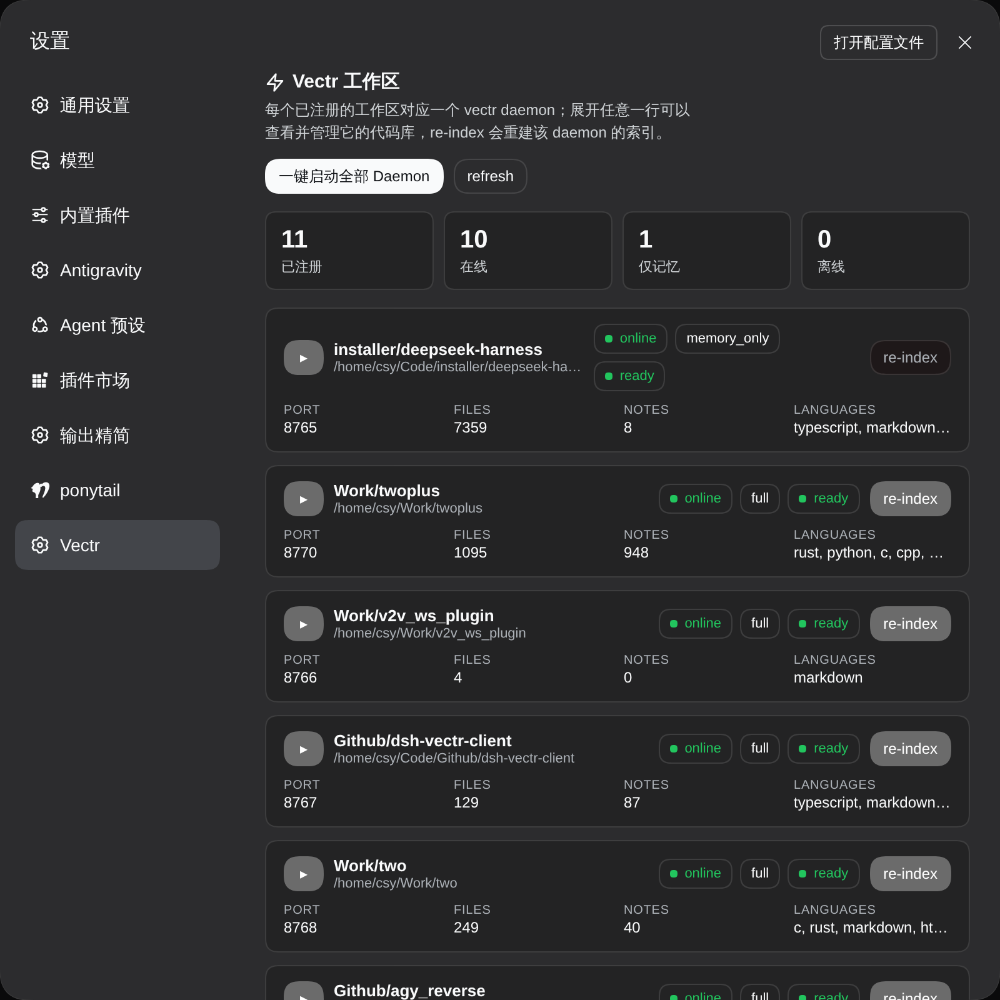
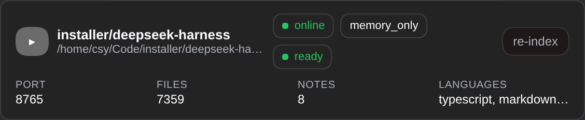

[English](README.md)

# dsh-vectr-client

> **基于 Vectr 开发 (Based on Vectr)**：本项目建立在 Swapnanil Saha 开发的 [Vectr](https://github.com/swapnanil/vectr) 之上，另有[官网与文档](https://swapnanilsaha.com/tools/vectr)。

这是 [DeepSeek Harness](https://github.com/deepseek-ai/deepseek-harness) 插件，给项目里的每个 Agent 两样东西：**语义检索 (Semantic Search)** 和**可靠工作记忆 (Reliable Working Memory)**。按意思找代码，不用满仓库 grep；笔记熬得过上下文压缩；新会话接着上次的进度干。一个工作区一套，自动接上。

## 能做什么

- **按语义找代码** —— 说清要找什么概念、符号或调用关系（比如“工作区锁在哪儿释放的？”）就能命中。工具挂在 `mcp__vectr__*` 下，只对当前 Agent 可见。
- **记忆熬得过上下文压缩** —— 存成笔记的发现，一次调用就能取回。本会话稍后能取，上下文被裁剪后能取，新开会话也能取。
- **目录自动对守护进程** —— 每个 Agent 启动时读会话 `cwd`，去 `~/.vectr/instances.json` 里找对应的守护进程连上。A 工作区拿不到 B 工作区的工具，也没有全局 MCP 配置要维护。
- **不阻塞，不挂死** —— 守护进程没装、已死或没响应，最坏就是“这个 Agent 没有 Vectr 工具”。原因连 workspace/cwd/port/pid 写进日志，Agent 照常干活。
- **输入框旁边看状态** —— 会话头部的胶囊显示状态、模式和端口；旁边那个触发器点开是控制台。
- **面板里能重建索引** —— 可以直接重建某个工作区的索引；重建不了时（仅记忆、正在索引、未就绪、离线），按钮的 tooltip 会说明原因。

## 怎么用

### 安装

先在本仓库所在的目录装本地检出：

```sh
dsh plugin --profile web add ./dsh-vectr-client
```

也可以从 git 装（仓库已提交编译产物，安装时不构建）：

```sh
dsh plugin --profile web add github:WinterSold1er/dsh-vectr-client
```

卸载：`dsh plugin --profile web remove dsh-vectr-client`。

`dsh plugin add` 只把包装进 Profile，**不改 Profile 清单**。还要把这个包列进 Profile 的 `dsh.profile.bundles`——手动改 Profile 的 `package.json`，或者用插件管理界面加上。装完**重启宿主**：`/api/vectr/*` 路由和 Settings 分区都是启动时注册的。

前提是 Vectr 已装好，且至少一个项目被它索引过。绑定需要一个已注册的守护进程（`~/.vectr/instances.json` 里有它）；插件不会替你装 Vectr，也不会建初始索引。

### 打开面板

进 **Settings → Vectr**。顶部是统计条（已注册 / 在线 / 仅记忆 / 离线），下面每个工作区一张卡片，写着路径、状态、模式、端口、文件数、笔记数和语言。工具栏里有 `一键启动全部 Daemon`。空状态和错误状态都是真的——接口挂了就显示接口返回的实际错误，不会给你一张空表。



### 启动 Daemon

点 `一键启动全部 Daemon`，一次请求拉起所有已注册的守护进程，并逐个工作区列出结果。按钮就在上面那张图的工具栏里。

### 直接提问

开任意会话，直接问代码。不用 grep，也不用报路径。

输入框旁边有个 Vectr 按钮，点开是控制台；面板标题旁也有插件自己的标记。


守护进程是什么模式，决定了它能不能重建索引。`memory_only` 的照样提供检索和记忆，只是重建不了索引：按钮禁着，原因写在 tooltip 里。就绪的守护进程，在面板上点一下就能一键重建索引。



## 配置

| 配置项 | 默认值 | 说明 |
|---|---|---|
| `instancesPath` | `~/.vectr/instances.json` | 守护进程注册表文件 |
| `serverName` | `vectr` | 工具命名空间 `mcp__<serverName>__*` |
| `toolCallTimeoutMs` | `60000` | 单次 Vectr 工具调用超时 |
| `reconnect.enabled` | `true` | 连接断了自动重连（同一端口） |

其余键（codebase/secret 路径、守护进程/CLI/召回/升级超时）见 `src/index.ts` 里的 `Config` schema。`cordis.patch.yml` 只插一行 `serverName: vectr`，要改就在自己 Profile 的 patch 文件里覆盖。

## 已知限制

- **首轮请求可能赶早** —— 连接是异步建立的，守护进程死了也挡不住 Agent。代价是第一条提示词有时在工具注册前就跑起来，下一步就有工具了。绑定失败也一样安静：Agent 就是没有 Vectr 工具，原因会连 workspace/cwd/port/pid 一起写进日志。
- **守护进程换端口后要新会话** —— 重连只认原端口，新端口要等下一次 `agent/created`。挪完守护进程，开个新会话。
- **控制台要重启宿主才出现** —— 路由和面板都在启动时注册。

关于图标，说实话：设置**左侧导航**那个图标由 Harness 宿主按固定的 id→图标映射决定，认不出来的 id 回落成设置齿轮，插件设不了。插件自己的标记在面板标题旁边和输入框旁边。

## 开发

```sh
pnpm typecheck
pnpm test
pnpm build
```

`lib/` 已提交，用的人不用构建。

## 致谢

- [Vectr](https://github.com/swapnanil/vectr)，作者 [Swapnanil Saha](https://swapnanilsaha.com/tools/vectr)：语义索引、工作记忆存储和守护进程。
- 本插件是它在 [DeepSeek Harness](https://github.com/deepseek-ai/deepseek-harness) 上的集成层。

## 许可证

MIT —— 见 `package.json`。
